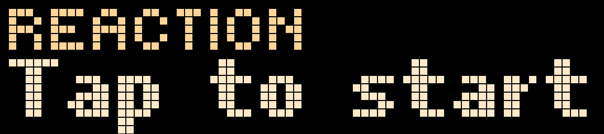
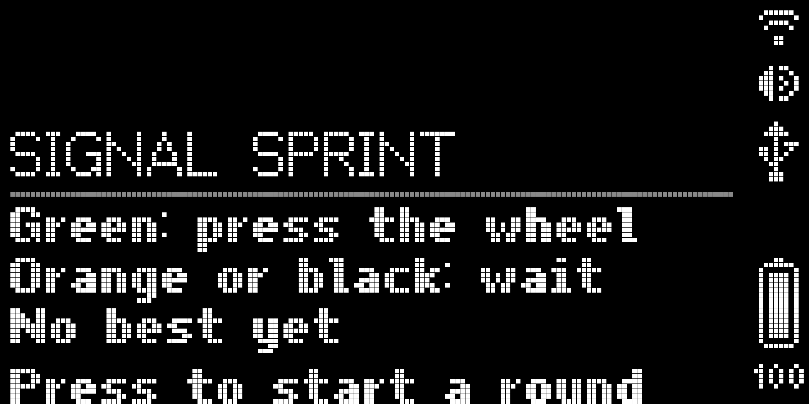

# Signal Sprint

Test a single button press against a visual cue. Green starts the response clock. Orange calls for restraint. The timer starts when the firmware acknowledges drawing the green frame and stops on the wheel’s press edge.

## Screen transitions

Wait through black. The green cue starts the reaction clock immediately. Pressing on orange brings up the miss.



<details>

<summary>Watch the rear display</summary>



</details>

## Setup

No settings or companion are required. Rest a finger on the wheel. Use an ordinary press. Timing in the emulator includes host input and rendering delays.

## Start a round

Click the wheel. The display goes black for a random delay. Wait through orange. When green appears, press once. Read the result in milliseconds and your saved best on the rear.


## Recover after an early press

Pressing on black gives Too early. Pressing on orange gives Wrong color. After the feedback animation, press again to start the next round. Holding through orange leads to another random cue.


## Run in the emulator

Install BUSY Bar Emulator and open it. From this repository run the following command, then press **Back** when you finish.

```sh
~/.busy-emulator/bin/busy-emulator dev --once
```

The recordings show device controls on emulator firmware. Each LED occupies a 16 × 16 cell with a black border.

[Rear display](screenshots/back-1.png) · [MIT license](LICENSE)
